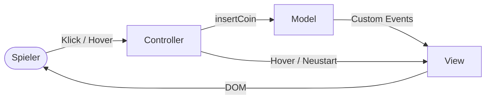

# Linux vs MacOS – Vier gewinnt

Ein „Vier gewinnt“ im Browser, umgesetzt mit HTML, CSS und JavaScript (ohne Frameworks). Zwei Rivalen kämpfen gegeneinander um das bessere Betriebssystem: **Linux** gegen **MacOS**.

Entstanden als **Übungsblock 05** an der FH Hagenberg, SS 2026. Die Aufgabe war, aus dem klassischen Spiel ein ansprechendes digitales Produkt mit Hintergrundgeschichte zu machen, mit sauberer Trennung nach **MVC** und Kommunikation über **Custom Events**.

## Die Geschichte

Linux und MacOS streiten seit Jahren darüber, wer das bessere Betriebssystem ist. Jetzt wird der Streit am Spielbrett entschieden. Linux spielt mit gelben Steinen, MacOS mit grauen. Wer zuerst vier Steine in eine Reihe bringt, darf sich für die nächste Runde das bessere System nennen.

## Features

- **Spielen per Klick in die Spalte:** Ein Klick auf ein beliebiges Feld wirft den Stein in diese Spalte. Er fällt bis zum untersten freien Platz.
- **Hover-Vorschau:** Fährt man mit der Maus über das Brett, werden die freien Felder der Spalte hervorgehoben. So sieht man, wo der Stein landen wird.
- **Aktiver Spieler wird hervorgehoben:** Die Figur des Spielers, der am Zug ist, wird farbig und leicht vergrößert. Die andere ist ausgegraut. Zusätzlich steht oben, wer dran ist.
- **Warnung bei voller Spalte:** Ist eine Spalte voll, erscheint der Hinweis „This column is full!“, und der Spieler ist weiter am Zug.
- **Gewinnsteine werden markiert:** Die vier (oder mehr) Steine, die zum Sieg geführt haben, leuchten grün auf, und der Gewinner wird angesagt.
- **Unentschieden:** Ist das Brett voll und niemand hat gewonnen, endet das Spiel unentschieden.
- **Neue Runde:** Der Button „Battle again!“ setzt das Spiel zurück.
- **Hintergrundmusik:** Über den Audio-Player lässt sich Musik zum Spiel abspielen.

## Spielregeln

Die Spieler werfen abwechselnd einen Stein in eine der sieben Spalten des 7 × 6 großen Bretts. Linux beginnt. Gewonnen hat, wer zuerst vier eigene Steine in eine Reihe bringt: waagrecht, senkrecht oder diagonal in eine der beiden Richtungen.

## Architektur (MVC)

Der Code ist in drei Teile getrennt, die nur über klar definierte Wege miteinander sprechen:



| Datei                           | Rolle |
|---------------------------------|-------|
| `js/model.connectfour.js`       | **Model:** die gesamte Spiellogik. Kennt das Brett als zweidimensionales Array, die Spieler und wer am Zug ist. Fügt Steine ein, prüft auf Sieg oder Unentschieden und merkt sich die Gewinnsteine. Weiß nichts über die Darstellung. |
| `js/view.polished.js`           | **View:** die Darstellung. Zeichnet das Brett, hebt den aktiven Spieler hervor, zeigt Meldungen und markiert die Gewinnsteine. Reagiert auf die Events des Models. |
| `js/controller.connectfour.js`  | **Controller:** startet das Spiel, nimmt Klicks und Mausbewegungen entgegen und gibt sie an Model bzw. View weiter. |

### Custom Events

Das Model meldet Änderungen über Events am `document`. Alle haben den Namensraum `connectfour:`, damit sie nicht mit anderen Events kollidieren:

| Event                      | wird ausgelöst, wenn …          | `detail` |
|----------------------------|---------------------------------|----------|
| `connectfour:insertCoin`   | ein Stein eingefügt wurde        | `{ player, row, column, board }` |
| `connectfour:playerchange` | der nächste Spieler dran ist     | `{ currentPlayer }` |
| `connectfour:gameover`     | jemand gewonnen hat oder das Brett voll ist | `{ winner, winningCoins, isDraw }` |

### Gewinnprüfung

Nach jedem Zug wird nur rund um den neu gesetzten Stein geprüft, nicht das ganze Brett. Für jede der vier Richtungen (waagrecht, senkrecht, diagonal ↘, diagonal ↗) zählt das Model gleichfarbige Steine vom neuen Stein aus in beide Richtungen. Sind es mindestens vier, ist das Spiel gewonnen. Die beteiligten Steine werden gespeichert und mit dem `gameover`-Event an die View übergeben.

## Projektstruktur

```
block-05-connect-four-EricKeplinger/
├── index.html                    Grundgerüst der Seite
├── style.css                     Layout und Gestaltung
├── js/
│   ├── model.connectfour.js      Model
│   ├── view.polished.js          View
│   ├── controller.connectfour.js Controller (Einstiegspunkt)
│   └── view.console.js           optionale Konsolen-View (nicht umgesetzt)
├── img/                          Hintergrund und Spielerfiguren
└── audio/                        Hintergrundmusik
```

## Starten

Das Spiel verwendet **JavaScript-Module** (`<script type="module">`). Browser laden Module aus Sicherheitsgründen nicht, wenn man `index.html` einfach doppelklickt (`file://`). Die Seite muss deshalb über einen lokalen Webserver geöffnet werden. Zum Beispiel:

- **WebStorm / IntelliJ IDEA:** `index.html` öffnen und rechts oben auf das Browser-Symbol klicken. Die IDE startet dann selbst einen Server.
- **VS Code:** mit der Erweiterung *Live Server* auf „Go Live“ klicken.
- **Kommandozeile** (im Projektordner):
  ```bash
  npx serve .
  # oder
  python -m http.server 8000
  ```
  Danach im Browser `http://localhost:8000` öffnen (bzw. die Adresse, die `npx serve` anzeigt).

## Schrift

Die Seite ist für die Pixel-Schrift **Monocraft** gestaltet. Die Schrift ist nicht im Projekt enthalten. Ist sie nicht installiert, zeigt der Browser eine normale Monospace-Schrift an.

## Verwendete Medien

| Datei | Verwendung | Quelle / Lizenz |
|-------|------------|-----------------|
| `audio/91476_Glorious_morning.mp3` | Hintergrundmusik | *bitte ergänzen* |
| `img/dark-blue-vignette-wwxoqm0ysa81ukl6.jpg` | Seitenhintergrund | *bitte ergänzen* |
| `img/linux.png` | Spielerfigur Linux | *bitte ergänzen* |
| `img/macOS.png` | Spielerfigur MacOS | *bitte ergänzen* |

## Eigene Arbeit und Vorgaben

Vorgegeben waren die Aufgabenstellung und die Dateistruktur mit `TODO`-Kommentaren, die beschreiben, was Model, View und Controller leisten sollen.

Selbst umgesetzt wurden:
- die Spiellogik im Model, inklusive Gewinnprüfung in alle vier Richtungen und Erkennung von Unentschieden
- die Custom Events und ihre Anbindung an die View
- die Darstellung des Bretts, die Hervorhebung des aktiven Spielers und die Markierung der Gewinnsteine
- die Steuerung per Klick ins Spielfeld mit Hover-Vorschau
- die Geschichte „Linux vs MacOS“ und die visuelle Gestaltung

## Autor

Eric Keplinger, FH Hagenberg
